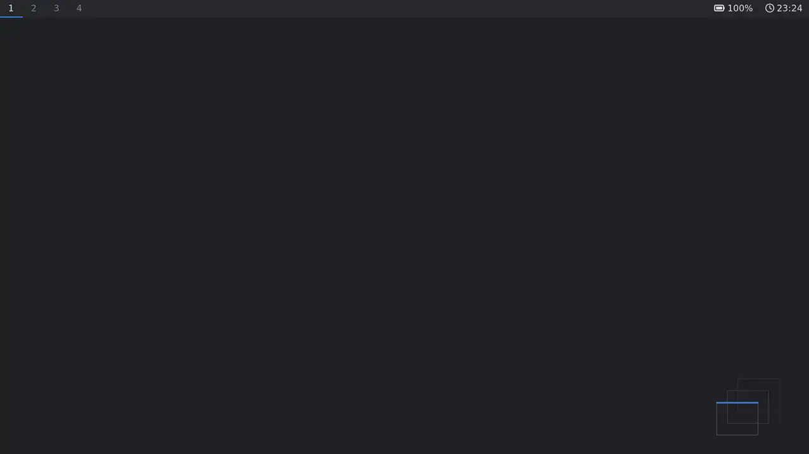

<p align="center">
  <picture>
    <source media="(prefers-color-scheme: dark)" srcset="https://raw.githubusercontent.com/igalmarino/pila/main/docs/logo/pila-logo-dark.svg">
    
  </picture>
</p>

# Pila

[](https://github.com/igalmarino/pila/actions/workflows/ci.yml)

A stacking (floating, not tiling) Wayland compositor written in Rust using [Smithay](https://github.com/Smithay/smithay).
Windows float, overlap, and have title bars, much like a traditional desktop.

**Who it's for:** People who like modular layer-shell tools (waybar, fuzzel, mako, swaylock, or a
full desktop shell) but prefer overlapping windows over tiling. Pila handles windows, title bars,
the window switcher, and the overview, while leaving the bar, launcher, notifications, wallpaper,
and lock screen to standard Wayland tools. Everything is configured in a single TOML file that
reloads on save.



## Try it

The safest way to try Pila is nested inside a window on your current desktop. It won't touch your
existing setup:

```bash
cargo run --release
```

When running nested, the Mod key is **Alt**: `Mod+Return` opens a terminal and `Mod+Shift+E` quits.
On a TTY or in a login session, Mod is **Super**. See
[Getting out](https://github.com/igalmarino/pila/blob/main/docs/INSTALL.md#getting-out) if you
ever need to exit from a TTY session.

## Install

`pila-desktop` installs Pila together with the default desktop tools. `pila` installs only the
compositor.

- **Debian, Ubuntu, Fedora:** Signed APT and DNF repositories
  ([setup](https://github.com/igalmarino/pila/blob/main/docs/INSTALL.md#debian-ubuntu-and-fedora)).
- **Arch Linux:** [`pila-git`](https://aur.archlinux.org/packages/pila-git) and
  [`pila-desktop`](https://aur.archlinux.org/packages/pila-desktop) in the AUR.
- **Nix and NixOS:** `nix run github:igalmarino/pila`, or configure it as a login session.
- **From source:** `scripts/install`.

Full installation instructions are in
[docs/INSTALL.md](https://github.com/igalmarino/pila/blob/main/docs/INSTALL.md). Pila does not
require systemd; logind, elogind, and seatd all work.

## Status

Pila is currently **alpha**. It's usable day to day, though development happens on a single
machine: an AMD laptop with an external monitor running Arch Linux. Testers have also reported it
working on Intel GPUs, Debian, NixOS, and one NVIDIA card (a GTX 1060).

Known gaps include touchscreens and drawing tablets. Multi-GPU output support (monitors wired to a
second GPU) is disabled by default and hasn't been tested on real hardware yet. See the
[roadmap](https://github.com/igalmarino/pila/blob/main/docs/ROADMAP.md) for what's planned next.

## Help test Pila

The biggest unknown right now is hardware diversity: NVIDIA (especially newer GPUs), Intel,
dual-GPU laptops, non-systemd setups, high refresh rates, 4K displays, and mixed monitor scaling.

1. [Try it nested](#try-it) first.
2. On bare metal, switch to a spare TTY (`Ctrl+Alt+F3`), log in, and run `pila-check`. It drives
   real programs for about a minute and prints `PASS` or `FAIL` for each check along with frame
   times.
3. Submit a [test report](https://github.com/igalmarino/pila/issues/new?template=test_report.yml)
   (even if everything works cleanly) or a [bug report](#reporting-bugs).

## Documentation

- [User manual](https://github.com/igalmarino/pila/blob/main/docs/MANUAL.md) (also `man pila`):
  using and configuring Pila.
- [`config.example.toml`](https://github.com/igalmarino/pila/blob/main/config.example.toml): every
  configuration option and the default keybindings.
- [What sets Pila apart](https://github.com/igalmarino/pila/blob/main/docs/WHY-PILA.md): full
  feature list, design choices, and how Pila compares to other compositors.
- [`pila msg`](https://github.com/igalmarino/pila/blob/main/docs/IPC.md): IPC and scripting.
- [CHANGELOG](https://github.com/igalmarino/pila/blob/main/CHANGELOG.md).

## Reporting bugs

Open an [issue](https://github.com/igalmarino/pila/issues/new/choose) and attach `pila-report.txt`,
generated by running `pila-report`. It collects the Pila version, GPU and monitor info, and the end
of the log (redacting your username, hostname, and home directory) and doesn't upload anything
automatically. Still, look it over before posting. See the manual's
[Troubleshooting](https://github.com/igalmarino/pila/blob/main/docs/MANUAL.md#troubleshooting)
section for more details.

For questions and ideas, use [Discussions](https://github.com/igalmarino/pila/discussions).

## Use of AI

Pila is built with AI assistance: [Claude Code](https://claude.com/claude-code) helps write code,
tests, documentation, and changelog entries, and translates my notes into English. Commits it
contributes to carry a `Co-Authored-By` trailer, and its instructions are public in
[CLAUDE.md](https://github.com/igalmarino/pila/blob/main/CLAUDE.md).

The engineering decisions (technology, architecture, security, testing, and scope) are mine. I review
what gets merged and take responsibility for it, and every feature has integration tests that run
in CI on every push. When contributing to other projects, I follow their rules on AI. For details on
how this workflow works and what has gone wrong along the way, see
[How Pila is made](https://github.com/igalmarino/pila/blob/main/docs/HOW-PILA-IS-MADE.md).

Contributions made with AI assistance are welcome under the same terms: mention it in the pull
request, and only submit code you understand and can stand behind.

## Contributing

See [CONTRIBUTING.md](https://github.com/igalmarino/pila/blob/main/CONTRIBUTING.md).

## License

GPL-3.0-or-later. See [LICENSE](https://github.com/igalmarino/pila/blob/main/LICENSE).
