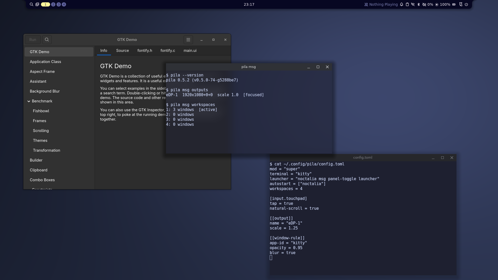

# pila

[](https://github.com/igalmarino/pila/actions/workflows/ci.yml)

A stacking (not tiling) Wayland compositor written in Rust on [Smithay](https://github.com/Smithay/smithay).
Windows float and overlap, with server-side title bars, like a classic desktop; panels,
launchers, wallpapers and lock screens come from the usual Wayland tools (waybar, fuzzel,
swaybg, swaylock, ...).

pila prefers **standard protocols**: Wayland core and the official `wayland-protocols`.
The wlroots protocols that panels and shells still need and that have no standard
replacement yet (layer shell, screencopy, foreign toplevel management, gamma control,
output management and power management, virtual keyboard) are supported too, each to be
replaced when an `ext-` version lands.



## Status

pila is **alpha**: usable day to day (its author runs it as their only desktop and
develops it from inside itself), but developed on one machine: an AMD laptop (Mesa, `amdgpu`)
with an external monitor, on Arch Linux with GDM. Testers report it working on Intel integrated
GPUs, on Debian with SDDM and on NixOS. NVIDIA hasn't been tried. Other GPUs, distros and setups
are exactly what testing is needed for: please [report](#reporting-bugs) what works and what
doesn't.

Known gaps: touchscreens, drawing tablets, input methods (IME), several GPUs (pila uses the
seat's primary one).

## Help test pila

The biggest unknown is how pila behaves away from its author's laptop. Most useful right
now, in this order:

- **NVIDIA**, which has never been tried, and **Intel** or other AMD GPUs. On a laptop with two
  GPUs, pila draws with the seat's primary one, often the integrated one: `pila-report` says which;
- **no systemd** (Void, Alpine, with elogind or seatd), and other **distros**, such as
  [Ubuntu and Fedora](#debian-ubuntu-and-fedora);
- **display managers** other than GDM and SDDM (greetd, LightDM);
- **monitors:** high refresh rates, 4K, mixed scales, several at once;
- **other shells and apps:** bars, launchers, games, Steam, Electron.

A short report helps even if everything works:

1. [Try it nested first](#try-it-nested-first): it changes nothing on your system.
   [Getting out](#getting-out) says how to leave a real session.
2. For your real hardware, from a built checkout (`cargo build --release`), run `scripts/check`
   on a spare TTY, which leaves your session running. It starts real programs for about a
   minute, quits by itself and prints PASS or FAIL per check, with frame times. Its log is
   `pila-tty.log`. For a package or Nix's build, a checkout still has the script:
   `PILA_BIN=/usr/bin/pila scripts/check`.
3. Send a [test report](https://github.com/igalmarino/pila/issues/new?template=test_report.yml)
   with what you tried and what worked, or a [bug report](#reporting-bugs) for what didn't.

## Features

- **Windows:** server-side title bars (minimize, maximize, close) and resize borders, or
  client-side decorations for apps that draw their own; Mod+drag to move and resize;
  maximize and fullscreen; snapping to screen halves and quarters by keyboard or by dragging to
  an edge or corner; moving, resizing and centering from the keyboard; minimize; showing the
  desktop; keeping a window above the others or on all workspaces; moving windows and focus
  between monitors; switching by recent use (Mod+Tab); workspaces spanning all monitors (Mod+1..N,
  four-finger swipes); a shadow under each window (`[shadow]`); optional rounded corners
  (`corner-radius`); your own colors (`[colors]`).
- **Animations**, short and subtle: windows opening, closing, minimizing, maximizing and
  snapping; launchers and notifications; workspaces sliding. Configurable, or off.
- **Window and layer rules** by app id, title or namespace: animations, workspace, size,
  position, maximized or fullscreen, always on top, on all workspaces, title bar, corner radius,
  opacity, blur and shadow per app; blur and animations per panel or launcher.
- **Monitors:** several at once, hotplugged, each with its own mode, position, rotation
  and (fractional) scale.
- **X11 apps** through Xwayland, with the clipboard shared both ways.
- **Desktop tools:** layer shell (waybar, fuzzel, mako, swaybg), session lock (swaylock),
  idle notification and inhibition (swayidle, video players), clipboard managers
  (ext-data-control), screenshots (grim, screencopy) and screen sharing
  (xdg-desktop-portal-wlr, for browsers and OBS), taskbars that act on windows
  (foreign-toplevel-management), night light (gamma control), screen off and monitor
  settings (output power and management), blur behind panels and windows (background-effect),
  workspace indicators and switchers (ext-workspace), a visual system bell, dialogs that stay
  above their window and modal ones that keep the focus (xdg-dialog), window rules by tag
  (xdg-toplevel-tag), Vulkan's FIFO presentation (wp-fifo, wp-commit-timing), explicit sync
  (linux-drm-syncobj). Enough for a full shell such as Noctalia.
- **Input:** keyboard layout and repeat, touchpad and mouse settings (tap, natural scrolling,
  speed, disable while typing, ...), three-finger swipes to switch windows and maximize,
  four-finger swipes to switch workspaces (configurable), other touchpad gestures for apps,
  pointer lock and confinement for games, any key bindable (media keys included).
- **Configuration** in one TOML file, applied live when saved.
- **Scripting:** `pila msg` lists windows, monitors and workspaces as text or JSON and runs any
  action ([docs/IPC.md](docs/IPC.md)).

## Running pila

pila runs on a TTY of any Linux machine (DRM/KMS, libinput, and a session from logind,
elogind or seatd; systemd isn't required), or nested as a window inside another Wayland or
X11 session.

### Try it nested first

The safest first run: build it (below) and start it from your current desktop. It opens
as a window, with a terminal inside, and nothing else on your system changes:

```bash
cargo run --release
```

Nested, Mod is **Alt** (your desktop keeps Super). Mod+Return opens a terminal, Mod+Shift+E
quits. Closing the window works too.

### Getting out

On a TTY or as a login session, Mod is **Super**:

- **Super+Shift+E** quits pila (back to the login screen or the TTY).
- **Ctrl+Alt+F1..F12** switch to another virtual terminal, where you can log in and
  `pkill pila` if the screen stops responding.
- If the pila session doesn't start, pick your usual session at the login screen and
  look at the log (see [Reporting bugs](#reporting-bugs)); `scripts/uninstall` (or
  removing the package) takes the session entry away.

### Building

pila needs Rust 1.89 or newer. If your distro's Rust is older, install it with
[rustup](https://rustup.rs). It also needs `pkg-config` and the development files of
`libseat`, `libinput`, `libudev`, `gbm` (Mesa) and `xkbcommon`. At runtime it loads EGL
(Mesa) and starts `Xwayland` for X11 apps. Package names on common distros (they may
differ between releases):

| Distro | Packages |
| - | - |
| Arch | `seatd libinput systemd-libs mesa libxkbcommon xorg-xwayland pkgconf` |
| Debian, Ubuntu | `libseat-dev libinput-dev libudev-dev libgbm-dev libxkbcommon-dev libegl1 xwayland pkg-config` |
| Fedora | `libseat-devel libinput-devel systemd-devel mesa-libgbm-devel libxkbcommon-devel mesa-libEGL xorg-x11-server-Xwayland pkgconf-pkg-config` |
| openSUSE | `libseat-devel libinput-devel libudev-devel libgbm-devel libxkbcommon-devel Mesa-libEGL1 xwayland pkg-config` |
| Void | `libseat-devel libinput-devel eudev-libudev-devel libgbm-devel libxkbcommon-devel mesa xorg-server-xwayland pkg-config` |
| Alpine | `libseat-dev libinput-dev eudev-dev mesa-dev libxkbcommon-dev xwayland pkgconf` |

Then `cargo build --release`.

### Debian, Ubuntu and Fedora

From 0.2.2 on, each [release](https://github.com/igalmarino/pila/releases) has a `.deb` (for
Ubuntu 24.04 or newer and Debian 13 or newer) and a `.rpm` (for the Fedora current at the time
of the release), for x86_64. Download one and install it, which brings what it needs:

```bash
sudo apt install ./pila_*.deb    # Debian, Ubuntu
sudo dnf install ./pila-*.rpm    # Fedora
```

They install the same files as `scripts/install` in `/usr`, and there's no repository yet, so
updating means installing a newer one. Each package is installed on a clean system and started
headless before it's attached to a release. A tester reports a real session working on Debian, with
SDDM; on Ubuntu and Fedora it hasn't been tried yet: please [report](#help-test-pila) how it goes.

### Nix and NixOS

The repository is a flake, which builds the latest `main`, like the AUR package. It needs
[flakes enabled](https://wiki.nixos.org/wiki/Flakes) and, on NixOS, graphics drivers on the
system (`hardware.graphics.enable = true`).

```bash
nix run github:igalmarino/pila           # try it: nested from your desktop, or from a TTY
nix profile install github:igalmarino/pila
```

As a login session on NixOS, add the flake to your system's inputs
(`inputs.pila.url = "github:igalmarino/pila";`) and to its configuration:

```nix
{ inputs, pkgs, ... }:
let
  pila = inputs.pila.packages.${pkgs.stdenv.hostPlatform.system}.default;
in
{
  environment.systemPackages = [ pila ];
  services.displayManager.sessionPackages = [ pila ];
  # Screen sharing.
  xdg.portal = {
    enable = true;
    wlr.enable = true;
    configPackages = [ pila ];
  };
}
```

From a checkout, `nix develop` gives a shell with everything to build it (`cargo build
--release`). `scripts/install` isn't for NixOS: it writes to paths NixOS doesn't read its session
entries from.

`nix run` has been confirmed on a NixOS system. The login session above hasn't been tried yet:
please [report](#help-test-pila) how it goes.

### Arch Linux (AUR)

[`pila-git`](https://aur.archlinux.org/packages/pila-git) builds the latest `main` from
GitHub and installs the same files as `scripts/install` with `PREFIX=/usr` (plus the README
and `config.example.toml` in `/usr/share/doc/pila`):

```bash
git clone https://aur.archlinux.org/pila-git.git
cd pila-git
less PKGBUILD    # read what you're about to build and install
makepkg -si
```

To update it, `git pull` there and run `makepkg -si` again. Its `PKGBUILD` is kept in
`packaging/aur/pila-git`, where `makepkg -si` builds it too. Remove a hand install first
(`scripts/uninstall`). To publish a new version of the AUR package, regenerate `.SRCINFO`
(`makepkg --printsrcinfo > .SRCINFO`) and commit both files: a workflow (`aur.yml`) checks them
and, once the maintainer approves it, publishes them.

A `-git` package only needs updating when the `PKGBUILD` changes (dependencies, files);
`makepkg` picks up new commits by itself.

### As a login session

```bash
scripts/install                # builds the release binary and installs it
PREFIX=/usr scripts/install    # for display managers that only read /usr/share
```

This installs the binary and a session wrapper in `$PREFIX/bin`, a `pila` entry in
`$PREFIX/share/wayland-sessions` for the display manager, and the portal configs for
screen sharing in `$SYSCONFDIR/xdg`. `PREFIX` defaults to `/usr/local` and `SYSCONFDIR`
to `/etc`; `DESTDIR` stages the files for a distro package (see `scripts/install-paths`).
GDM reads `/usr/local`; LightDM and some SDDM setups need `PREFIX=/usr`.

The build uses the host's `cargo`. Without one, it falls back to the dev container
(`--container`), whose binary is linked against Arch's libraries and may not run
elsewhere. `--no-build` installs what's already in `target/release`. Before installing, it
checks that the binary runs on this system (a container build may need a newer glibc than
the host's), and warns if another pila session entry (e.g. a distro package's) is installed
too. Run it on the host, not inside the dev container.

This is the way to install your working tree while developing. The AUR package builds
what's on GitHub, so use it for a published version, and don't keep both installed.

Log out, pick *pila* (on GDM, the gear icon on the password screen), log in. The session
uses the user's D-Bus bus (and `systemd --user` where there is one) like any other
desktop, so portals, PipeWire and the keyring (unlocked by the display manager's PAM setup)
just work. Without a per-user bus (e.g. elogind or seatd without systemd), the wrapper
starts one for the session with `dbus-run-session`.

The log goes to `~/.local/state/pila/pila.log` (the previous run's is in `pila.log.old`).
A copy goes to the journal with systemd (`journalctl -t pila -b`), or otherwise to syslog
through `logger`. After changing pila, run `scripts/install` again and log out and back
in. `scripts/uninstall`, given the same variables, removes what it installed. Mod+Shift+E
ends the session (back to the login screen).

### By hand, on a TTY

On a free TTY (Ctrl+Alt+F3), from this folder:

```bash
scripts/tty                        # the release build with ~/.config/pila/config.toml
scripts/tty my-test.toml           # another config; --debug for the debug build
```

This lets you try a build or a config while another session (pila or anything else) keeps
running on another VT. This pila gets a D-Bus bus of its own (`dbus-run-session`), so its
portals don't touch the other session's services. The log (portals included) goes to
`pila-tty.log`, the previous run's to `pila-tty.log.old`. Ctrl+Alt+F1..F12 switch TTYs;
Mod+Shift+E quits.

Host packages for a full session (names are the same on most distros):

- `kitty`: the default terminal (or set `terminal`; foot, alacritty and others are found
  too)
- `xdg-desktop-portal-wlr`, `slurp`: screen sharing (`slurp` picks the screen to share)
- `grim`, `slurp`: screenshots; Mod+Ctrl+S needs `grim`, Mod+Shift+S both and `wl-clipboard`
- `xdg-desktop-portal-gtk`: the file chooser and other portals
- `libnotify` (`libnotify-bin` on Debian, Ubuntu): `notify-send`, which pila uses to tell you
  about an invalid config, for instance; a notification daemon must show them (Noctalia, mako, ...)
- `xdg-utils`: `xdg-open`, which programs such as kitty use to open links and files; without it
  a click on a link does nothing, and says nothing
- `wl-clipboard`: `wl-copy`, which Mod+Shift+S needs to put a region of the screen on the clipboard;
  without it, that binding does nothing
- `swaylock`: locking the session (bind it, or run it from swayidle)
- `pciutils`: `lspci`, with which `pila-report` names the GPU and its driver

```bash
sudo pacman -S kitty xdg-desktop-portal-wlr xdg-desktop-portal-gtk grim slurp libnotify xdg-utils wl-clipboard swaylock pciutils       # Arch
sudo apt install kitty xdg-desktop-portal-wlr xdg-desktop-portal-gtk grim slurp libnotify-bin xdg-utils wl-clipboard swaylock pciutils # Debian, Ubuntu
sudo dnf install kitty xdg-desktop-portal-wlr xdg-desktop-portal-gtk grim slurp libnotify xdg-utils wl-clipboard swaylock pciutils     # Fedora
```

### Desktop shells and tools

pila draws windows and title bars only; the rest of a desktop comes from the usual Wayland
tools: a bar (waybar), launcher (fuzzel), notifications (mako), wallpaper (swaybg), lock
screen and idle (swaylock, swayidle), night light (wlsunset), clipboard (wl-clipboard), all
started from `autostart`. A full shell such as [Noctalia](https://noctalia.dev) provides all
of these at once. To turn screens off on idle, use `wlopm` (`wlopm --off '*'`): shells that
don't recognize pila may run `wlr-randr --off` without naming an output, which fails.

## Configuring pila

pila reads `~/.config/pila/config.toml` (or `$XDG_CONFIG_HOME/pila/config.toml`, or the file
given with `--config`). [`config.example.toml`](config.example.toml) documents every option
and the default key bindings: the modifier key, terminal and launcher, programs to start with
pila (`autostart`), keyboard layout and repeat, key bindings, touchpad and mouse settings,
each monitor's mode, scale, rotation and position, the number of workspaces, rounded corners,
shadows (`[shadow]`), colors (`[colors]`), animations (`[animations]`) and per-app rules
(`[[window-rule]]`, `[[layer-rule]]`). A missing file means the defaults; an invalid one is
reported in the log and in a notification, and pila starts with the defaults. `PILA_MOD`, `PILA_TERMINAL` and
`PILA_LAUNCHER` override the file; `pila --help` lists the options.

Saving the file applies it right away, everything but `autostart`. If the new version is
invalid, pila keeps running with the previous one and shows the error in a notification
(with a notification daemon such as mako) and in the log. `pila --check-config` checks
the file, keyboard layout included, without starting pila: it prints what's wrong and
exits with status 1, or 0 if it's valid.

A few defaults (Mod is Super on a TTY or login session and Alt nested, unless `mod` says
otherwise): Mod+Return opens a terminal (kitty, or another one that is installed),
Mod+Tab switches windows, Mod+Left/Right snap, Mod+Up/Down maximize and restore, Mod+M
maximizes, Mod+F goes fullscreen, Mod+N minimizes, Mod+T keeps a window above the others, Mod+P
keeps it on all workspaces, Mod+H shows the desktop, Mod+O goes to the next monitor and
Mod+Shift+O sends the window there, Mod+Shift+S and Mod+Ctrl+S take screenshots (a region to the
clipboard, the screen to `~/Pictures`), Mod+Shift+Q closes, Mod+Shift+E quits.

## Reporting bugs

Open an [issue](https://github.com/igalmarino/pila/issues/new/choose). `pila-report`
(`scripts/report` in a checkout) gathers most of what's needed into `pila-report.txt`, without
your home directory, user name and host name, and sends nothing anywhere. By hand, it's:

- `pila --version`, your distro, GPU and driver (`lspci -k | grep -A3 VGA`);
- how pila was started: login session, `scripts/tty`, or nested;
- the log: `~/.local/state/pila/pila.log` for a login session (`pila.log.old` is the run
  before; with systemd also `journalctl -t pila -b`), `pila-tty.log` for `scripts/tty`, the
  terminal for nested. `RUST_LOG=debug` makes it detailed; after a crash,
  `RUST_BACKTRACE=1` adds where it happened;
- your config file, if you have one, and the steps to reproduce.

Look through logs and configs before posting them: they can hold window titles, commands,
file paths and monitor details.

Questions, ideas and "does X work with pila?" go to
[Discussions](https://github.com/igalmarino/pila/discussions).

## Use of AI

pila is developed with AI assistance: [Claude Code](https://claude.com/claude-code) helps
with programming and testing, and the commits it worked on carry a `Co-Authored-By`
trailer. The instructions it works under are public, in [CLAUDE.md](CLAUDE.md).

The AI doesn't make the decisions. The important ones, on technology, architecture,
security, testing and more, are mine; I'm a software developer with over 30 years of
experience. I review the code that goes in and I answer for it.

## Contributing

See [CONTRIBUTING.md](CONTRIBUTING.md) for conventions and the development environment (a
dev container in which pila runs nested on your desktop).

## License

pila is free software: you can redistribute it and/or modify it under the terms of the GNU
General Public License as published by the Free Software Foundation, either version 3 of
the License, or (at your option) any later version. See [LICENSE](LICENSE).
